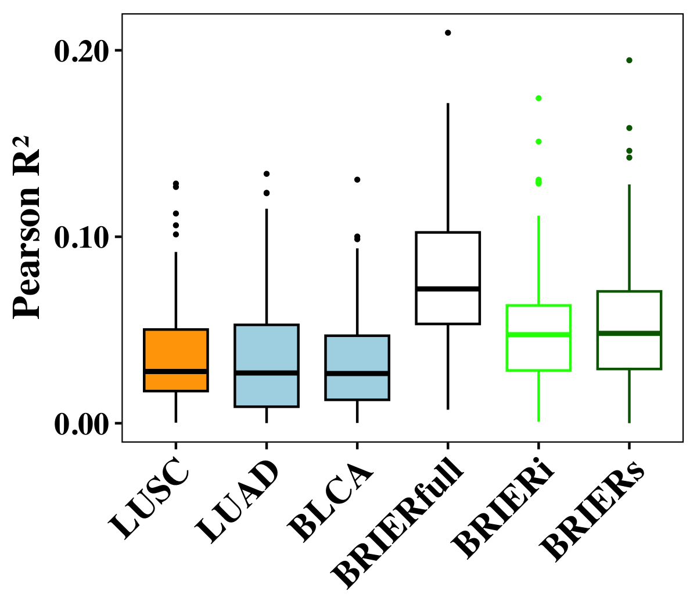
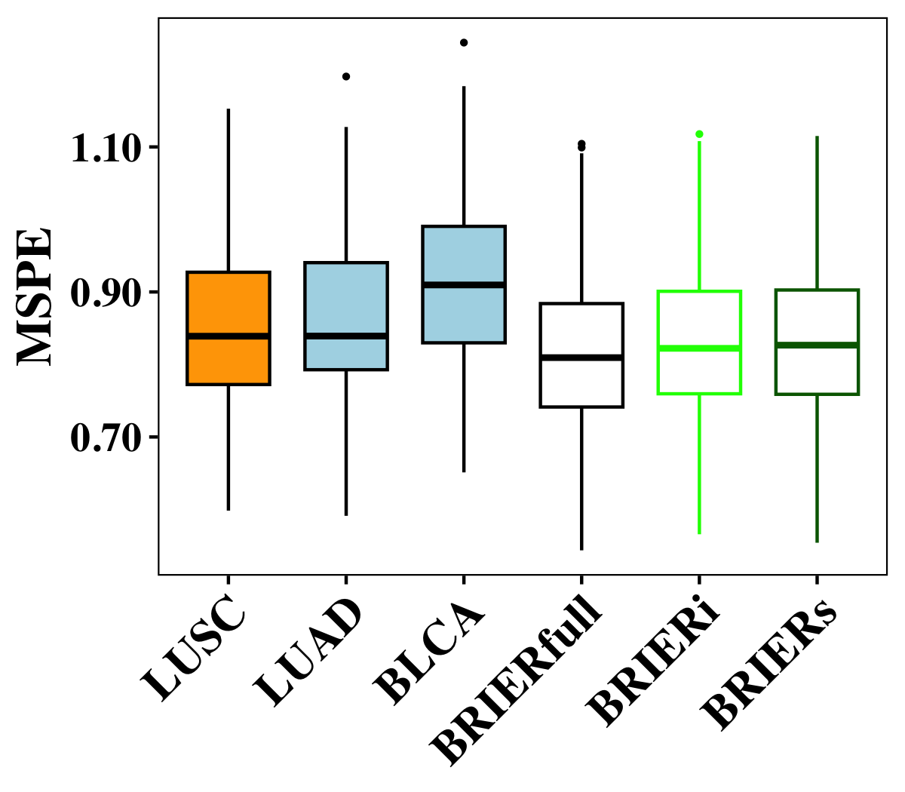

```{r setup, include = FALSE}
knitr::opts_chunk$set(
  eval = FALSE,
  warning = FALSE,
  message = FALSE
  )
```


# 1. Introduction {#sec-intro}

`BRIER` is not limited to SNPs: the predictors can be any features shared by the target and the external sources. This example predicts tumour mutational burden (TMB) from gene expression in lung squamous cell carcinoma, using open-access data from The Cancer Genome Atlas (TCGA):

- **Target**: TCGA-LUSC, 481 primary tumours. Outcome: $\log(1 + \text{TMB})$. Predictors: 2,000 genes (log2 batch-corrected expression).
- **External sources**: two other cancers, lung adenocarcinoma (TCGA-LUAD) and bladder urothelial carcinoma (TCGA-BLCA).

Because the external cohorts are open access, the same external information can be given to `BRIER` in all three forms, so the three modules can be compared on one problem:

| Module | The target provides | The externals provide |
|---|---|---|
| `BRIERfull` | individual-level data | their raw training tumours |
| `BRIERi` | individual-level data | their lasso coefficients |
| `BRIERs` | summary statistics $X^\top y / n$ and the gene correlation matrix $X^\top X / n$ | the same lasso coefficients |

Every input, script and result is in the Zenodo deposit (DOI: to be added), folder `TCGA_example/`:

| Folder | Content |
|---|---|
| `data/` | fit-ready inputs: target train, validation and test sets, summary statistics, gene correlation matrix, external data and coefficients |
| `scripts/` | `01_download.sh`, `02_preprocess.R`, `03_fit.R`, `04_eval.R` |
| `results/` | the three fitted `BRIER` objects and their selected coefficients |
| `figures/` | eta lines, boxplots and a summary on the test tumours |

The code below is abridged from those scripts. Run every script from the `TCGA_example/` folder. Steps 2 and 3 can be skipped, since `data/` already holds their output.


# 2. Downloading the data {#sec-download}

`scripts/01_download.sh` downloads the PanCanAtlas batch-corrected RNA-seq and the TCGA phenotype table from UCSC Xena, and the TMB of each tumour from cBioPortal.

```{bash}
bash scripts/01_download.sh
```


# 3. Preparing fit-ready data {#sec-preprocess}

`scripts/02_preprocess.R` follows these steps:

1. Keep primary tumours with expression and TMB, one per patient.
2. Keep genes with no missing values, a mean log2 expression above 1, and nonzero variance in every cohort. Of these, keep the 2,000 with the largest average within-cohort variance across LUSC's 12 comparison cancers, so no target data are used to choose genes.
3. Split LUSC once into training (288), validation (96) and test (97) tumours. Standardize genes and outcome with the training mean and standard deviation, and compute the summary statistics and gene correlation matrix from the training tumours.
4. Split each external cohort 80 / 20 and fit a lasso on its 80%, with $\lambda$ chosen on its own 20%. These coefficients are the external models given to `BRIERi()` and `BRIERs()`.

```{r}
library(dplyr)
library(Matrix)
library(BRIER)

target = readRDS("data/target_LUSC.rds")              # train, validation, testing: X and y
sumstats = data.table::fread("data/sumstats_LUSC.txt", data.table = FALSE)   # gene, corr, n
LD = readRDS("data/LD_LUSC.rds")                      # 2,000 x 2,000 gene correlation matrix
externals = readRDS("data/externals.rds")             # LUAD, BLCA: X, y, beta
beta_external = sapply(externals, function(x){ x$beta })
```


# 4. Fitting the three modules {#sec-fit}

`scripts/03_fit.R` fits each module over a grid of 21 values of $\eta$ per external, 441 pairs $(\eta_{LUAD}, \eta_{BLCA})$ in all, and selects $(\eta, \lambda)$ by the mean squared prediction error (MSPE) on the LUSC validation tumours.

```{r}
eta_vec = c(0, exp(seq(log(0.1), log(100), length.out = 20)))

## BRIERi: target individual-level data + the two external lasso models
model_BRIERi = BRIERi(
  X = target$train$X,
  y = target$train$y,
  family = "gaussian",
  eta.list = list(eta_vec, eta_vec),
  beta.external = rbind(0, beta_external),        # first row: the intercept slot
  multi.method = "ind",
  dedup.cor = NULL,
  penalty = "LASSO",
  ncores = 4
)
model_BRIERi = BRIERi.selection(
  model_BRIERi,
  criteria = "gaussian.mspe",
  X.val = target$validation$X,
  y.val = target$validation$y
)

## BRIERs: target summary statistics and gene correlation matrix + the same external models
model_BRIERs = BRIERs(
  sumstats = sumstats %>% dplyr::select(corr, n),
  XtX = LD,
  family = "gaussian",
  eta.list = list(eta_vec, eta_vec),
  beta.external = beta_external,
  multi.method = "ind",
  dedup.cor = NULL,
  penalty = "LASSO",
  ncores = 4
)
model_BRIERs = BRIERs.selection(
  model_BRIERs,
  criteria = "gaussian.mspe",
  X.val = target$validation$X,
  y.val = target$validation$y
)

## BRIERfull: target training tumours + the externals' raw training tumours
model_BRIERfull = BRIERfull(
  X = rbind(target$train$X, externals$LUAD$X, externals$BLCA$X),
  y = c(target$train$y, externals$LUAD$y, externals$BLCA$y),
  cohort = rep(0:2, c(length(target$train$y), length(externals$LUAD$y), length(externals$BLCA$y))),
  family = "gaussian",
  eta.list = list(eta_vec, eta_vec),
  penalty = "LASSO",
  ncores = 4
)
model_BRIERfull = BRIERfull.selection(
  model_BRIERfull,
  criteria = "gaussian.mspe",
  X.val = target$validation$X,
  y.val = target$validation$y
)
```

All three fits take about 15 minutes on 4 cores, most of it `BRIERfull`. The selected coefficients come from `coef()`, and `results/coef_<module>.txt` stores them as gene, COEF.


# 5. Evaluation on the test tumours {#sec-eval}

`scripts/04_eval.R` computes test predictions with `predict()`, and compares the modules with `plot.box()` and `plot.eta()`. With two externals, `plot.eta()` returns the performance at every $(\eta_{LUAD}, \eta_{BLCA})$ pair as a table instead of a plot:

```{r}
pred_BRIERi = predict(model_BRIERi, X = target$testing$X)
evalMetric(pred_BRIERi, target$testing$y, "gaussian.rsq")

out_box = plot.box(
  model_BRIERi,
  X = target$testing$X,
  covar.data = target$testing$y,
  criteria = "gaussian.rsq",
  bootstrap.n = 100,
  seed = 20260912
)
out_box$plot          # target only (eta = 0), each external alone, BRIERi
```

On the single split above, test $R^2$ is 0.044 for the target-only lasso, 0.066 and 0.026 for the LUAD and BLCA models alone, and 0.052, 0.049 and 0.106 for `BRIERi`, `BRIERs` and `BRIERfull`.

One split of 97 test tumours is noisy. The figures below, from the method paper, keep the training tumours of this split fixed and redraw the validation and test tumours 100 times; each module is re-tuned on every validation draw. Shown are test Pearson $R^2$ (left) and MSPE (right) for the target-only model (LUSC), each external model alone (LUAD, BLCA), and the three modules:

<div style="display: flex; justify-content: space-between;">
  
  
</div>

How to read these results:

- **Neither the target nor the externals predict well alone.** The target-only lasso and the two external models each have a median test $R^2$ near 0.027.
- **Every module improves on all three.** `BRIERi` and `BRIERs` reach a median $R^2$ of about 0.048, and `BRIERfull` 0.072, with the lowest MSPE (median 0.81, against 0.84 for the target-only model).
- **More external information helps more.** `BRIERfull` sees the externals' raw tumours, while `BRIERi` and `BRIERs` see only their fitted coefficients, and the gain grows accordingly.
- **Summary statistics lose almost nothing.** `BRIERs`, which uses only $X^\top y / n$ and $X^\top X / n$ from the target, matches `BRIERi` on the full individual-level data.
