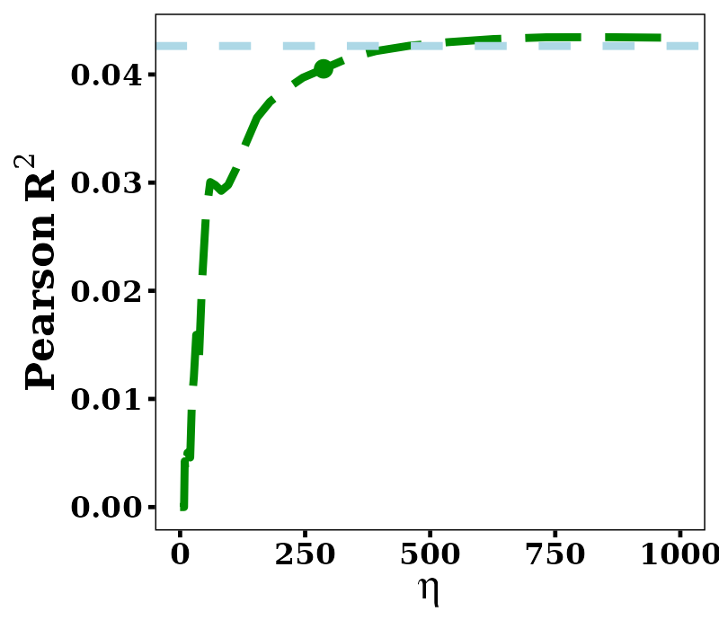
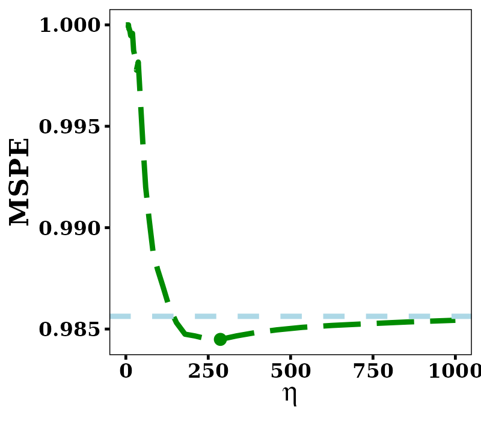
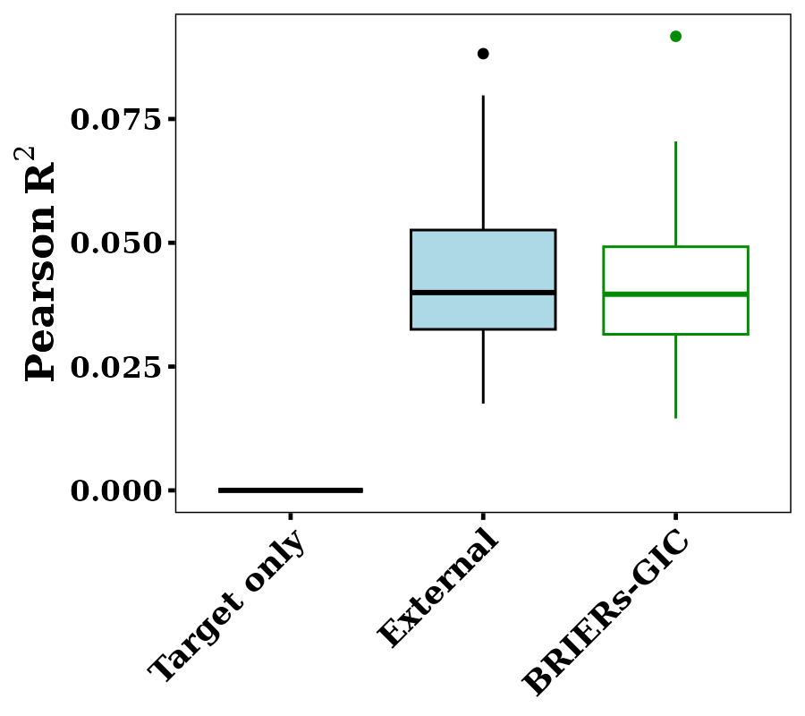
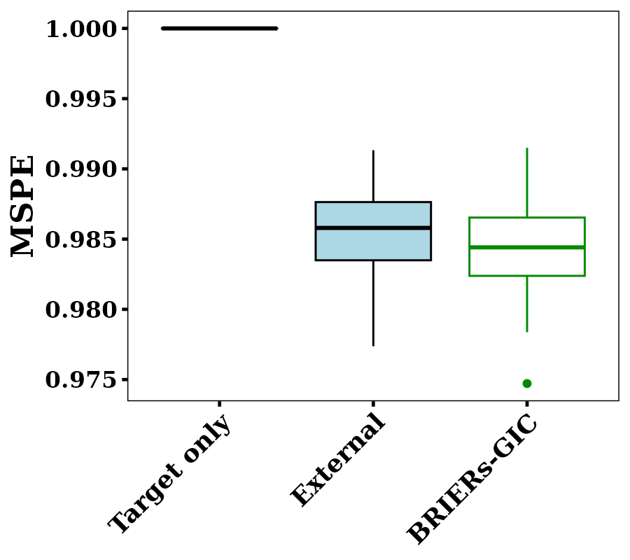
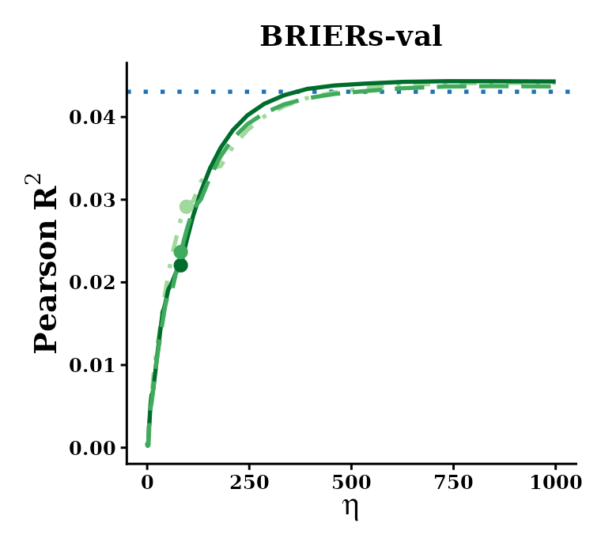
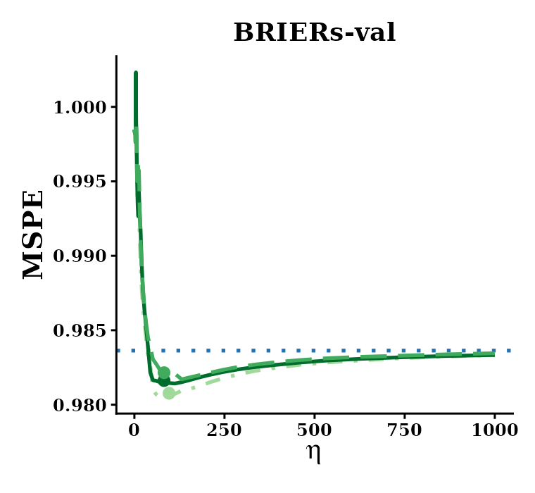
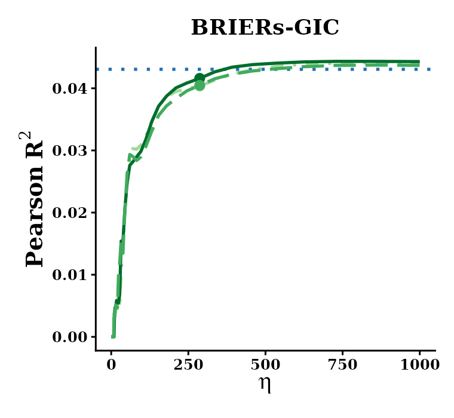
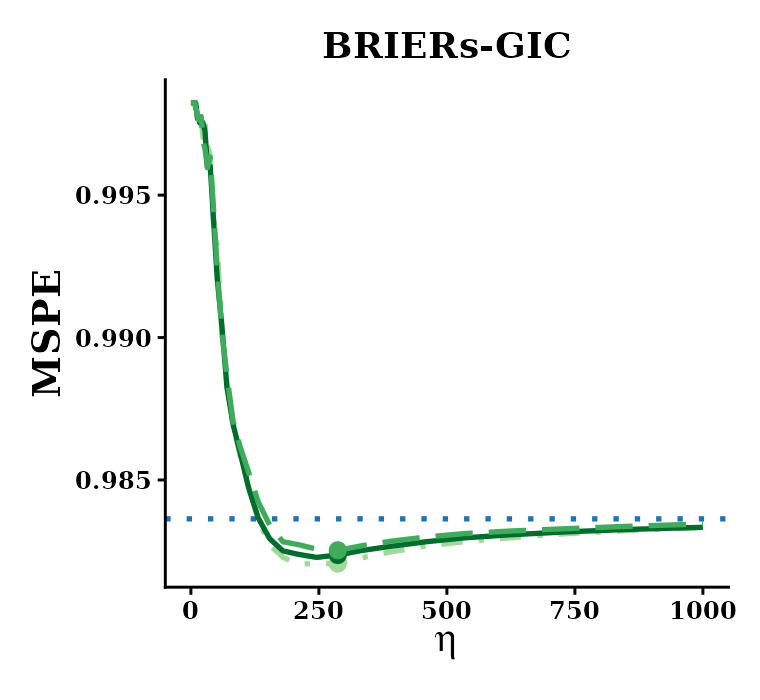
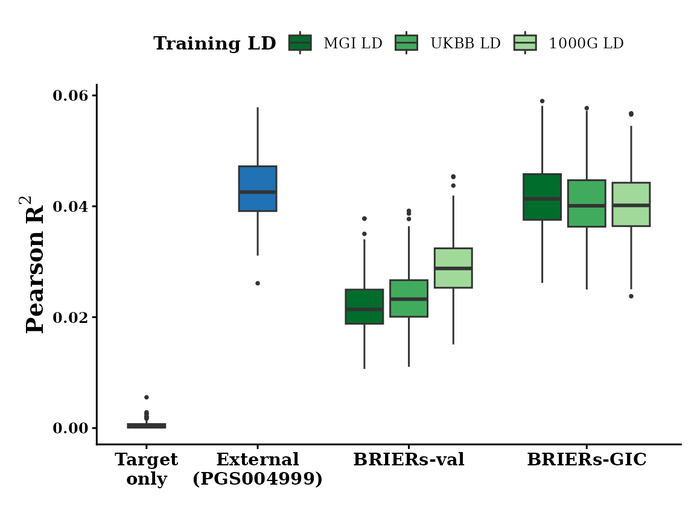
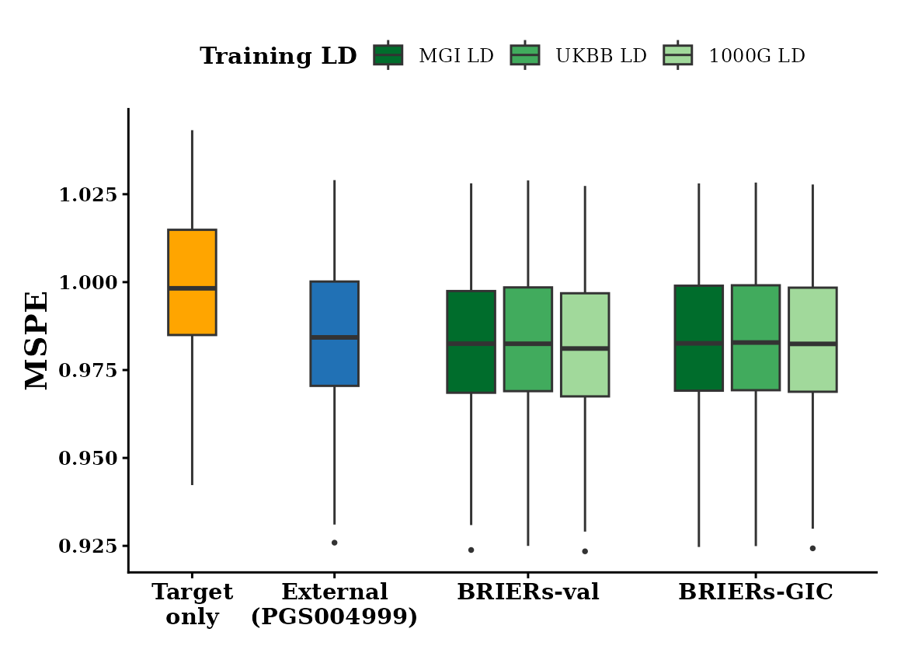

```{r setup, include = FALSE}
knitr::opts_chunk$set(
  eval = FALSE,
  warning = FALSE,
  message = FALSE
  )
```


# 1. Introduction {#sec-intro}

Polygenic risk scores (PRS) are far less accurate in African-ancestry (AFR) individuals than in European-ancestry individuals, mostly because AFR genome-wide association studies (GWAS) are small. This example builds a height PRS for AFR individuals with `BRIERs()`, using only public data:

- **Target**: the [Pan-UKB](https://pan.ukbb.broadinstitute.org) height GWAS of AFR participants (N = 6,556), as summary statistics.
- **External model**: the [PGS Catalog](https://www.pgscatalog.org) height score [PGS004999](https://www.pgscatalog.org/score/PGS004999/) (Gunn et al., *HGG Advances* 2024), a pretrained PRS whose development samples include no UK Biobank AFR participants.
- **LD**: the public UKBB AFR LD reference panel of [PRS-CSx](https://github.com/getian107/PRScsx).
- **Tuning**: the generalized information criterion (GIC), which needs no individual-level data.

The analysis uses 149,090 HapMap3 SNPs. Every input, script and result is on [Dropbox](https://www.dropbox.com/scl/fo/ite9396qhib2dlg68jl65/AAkfLkq1qT-PGeyexfk2LVw?rlkey=m3nurmzmefi5sjjlfstsboqld&dl=0), folder `panAFR_example/`:

| Folder | Content |
|---|---|
| `data/` | fit-ready inputs: aligned GWAS, LD matrix, external model, SNP list |
| `scripts/` | `01_download.sh`, `02_preprocess.R`, `03_fit.R`, `04_eval.R` |
| `results/` | the fitted `BRIER` object and the selected model's coefficients |
| `figures/` | eta lines, boxplots and a summary on the MGI test set (section 5) |

The code below is abridged from those scripts. Run every script from the `panAFR_example/` folder. Steps 2 and 3 can be skipped, since `data/` already holds their output.


# 2. Downloading the public inputs {#sec-download}

`scripts/01_download.sh` downloads three things into `raw/`: the Pan-UKB height summary statistics and phenotype manifest, the PRS-CSx UKBB AFR LD reference panel, and the harmonized PGS004999 scoring file.

```{bash}
bash scripts/01_download.sh
```


# 3. Preparing fit-ready data {#sec-preprocess}

`scripts/02_preprocess.R` aligns every input to the SNP list `data/snp_list.txt`, with the ALT allele as the effect allele throughout.

**Target summary statistics.** The Pan-UKB AFR effect sizes are matched to the SNP list by chromosome, position and allele pair, and turned into marginal SNP-trait correlations with `p2cor()`:

```{r}
library(dplyr)
library(Matrix)
library(BRIER)

snp_list = data.table::fread("data/snp_list.txt", data.table = FALSE)
GWAS_raw = data.table::fread(
  cmd = "zcat raw/continuous-50-both_sexes-irnt.tsv.bgz",
  select = c("chr", "pos", "ref", "alt", "beta_AFR", "neglog10_pval_AFR"),
  data.table = FALSE
) %>%
  dplyr::filter(chr %in% as.character(1:22)) %>%
  dplyr::mutate(chr = as.integer(chr))

GWAS = snp_list %>%
  dplyr::inner_join(GWAS_raw, by = c("CHR" = "chr", "BP_hg19" = "pos")) %>%
  dplyr::filter((alt == ALT & ref == REF) | (alt == REF & ref == ALT)) %>%
  dplyr::mutate(
    BETA = ifelse(alt == ALT, beta_AFR, -beta_AFR),
    P = 10^(-neglog10_pval_AFR),
    N = 6556
  ) %>%
  dplyr::mutate(corr = p2cor(P, N, sign = ifelse(BETA > 0, 1, -1)))
```

**LD.** `convertLDref()` reads the PRS-CSx panel one chromosome at a time, keeps the SNPs of your list, and aligns the LD signs to your ALT allele. The chromosomes are then stacked into one block-diagonal matrix:

```{r}
LD_list = lapply(1:22, function(chr){
  ld = convertLDref(
    dir = "raw/ldblk_ukbb_afr",
    SNP.info = snp_list %>% dplyr::filter(CHR == chr) %>% dplyr::select(SNP, CHR, REF, ALT),
    format = "prscs"
  )
  return(ld$XtX)
})
LD = as(as(Matrix::bdiag(LD_list), "generalMatrix"), "CsparseMatrix")
```

**External model.** The PGS004999 weights are matched by chromosome, GRCh38 position and allele pair; a swapped pair negates the weight. Because `BRIERs()` works on standardized genotypes, the per-allele weights are converted to the per-SD scale with the 1000 Genomes AFR allele frequency $p$, $\beta_{SD} = \beta \sqrt{2p(1-p)}$. The weights are not otherwise rescaled.


# 4. Fitting `BRIERs` and selecting by GIC {#sec-fit}

`scripts/03_fit.R` fits `BRIERs()` over 61 values of $\eta$ from 0 to 1000, then selects $(\eta, \lambda)$ by GIC with the GWAS sample size and the GWAS SNP heritability ($h^2 = 0.41$, Pan-UKB):

```{r}
GWAS = data.table::fread("data/GWAS_AFR.txt", data.table = FALSE)
LD = readRDS("data/LD_UKBB_AFR.rds")
external = data.table::fread("data/external_PGS004999.txt", data.table = FALSE)

eta_vec = c(0, exp(seq(log(0.1), log(1000), length.out = 60)))
model = BRIERs(
  sumstats = GWAS %>% dplyr::select(CHR, BP, REF, ALT, corr),
  XtX = LD,
  family = "gaussian",
  eta.list = list(eta_vec),
  beta.external = matrix(external$BETA, ncol = 1),
  penalty = "LASSO",
  lambda.min = 1e-3,
  eps = 1e-4,
  ncores = 8,
  parallel = TRUE
)
model = BRIERs.selection(model, criteria = "GIC", TN = 6556, h2 = 0.4148)
# Best eta: 286.832
# Best lambda: 3.84e-06
```

The fit takes about 15 minutes on 8 cores. GIC selects $\eta = 286.8$, a model with 136,950 nonzero SNP weights. The selected coefficients are obtained with `coef()`, and `results/coef_BRIERs_GIC.txt` stores them as CHR, BP, REF, ALT, COEF (per SD of the ALT dosage):

```{r}
beta = coef(model)
sum(beta != 0)
# [1] 136950
```


# 5. Evaluation on an independent test cohort {#sec-eval}

The model is evaluated on the Michigan Genomics Initiative (MGI) AFR cohort, a test set of 1,081 participants that played no part in fitting or tuning. Height is adjusted for age and sex. The MGI genotypes and phenotypes are controlled access and are not part of the deposit. `scripts/04_eval.R` shows the evaluation: set the three files at its top to evaluate on your own cohort.

`plot.eta()` evaluates the model at every $\eta$, each at its own GIC-best $\lambda$, and `plot.box()` compares the target-only model ($\eta = 0$), the external model alone and the selected `BRIER` model. Both regress out the covariates and standardize within each bootstrap subsample:

```{r}
out_eta = plot.eta(
  model,
  X = X_testing,                         # ALT dosages of the 149,090 SNPs
  covar.data = covar_data,               # columns trait, Gender_cat, Age
  criteria = "gaussian.rsq",
  pheno.name = "trait",
  adjust.covar = c("Gender_cat", "Age"),
  standardize.data = TRUE,
  bootstrap = TRUE,
  bootstrap.n = 100,
  seed = 20260912
)
out_box = plot.box(
  model,
  X = X_testing,
  covar.data = covar_data,
  criteria = "gaussian.rsq",
  pheno.name = "trait",
  adjust.covar = c("Gender_cat", "Age"),
  standardize.data = TRUE,
  bootstrap.n = 100,
  seed = 20260912
)
```

**Results.** Test performance of the model fitted above, with the UKBB AFR LD and tuned by GIC. The spread is over 100 bootstrap subsamples (80%) of the MGI test set.

**Test performance along $\eta$.** Test Pearson $R^2$ (left) and MSPE (right) of the model at each $\eta$, each at its own GIC-best $\lambda$. The dashed light blue line is the external PGS004999 alone, and the point marks the GIC-selected $\eta = 286.8$.

<div style="display: flex; justify-content: space-between;">
  
  
</div>

**Test performance of the selected models.** The target-only model ($\eta = 0$), the external alone, and `BRIERs` tuned by GIC.

<div style="display: flex; justify-content: space-between;">
  
  
</div>

| Model | Test $R^2$ | Test MSPE | $R^2$, bootstrap mean (SD) |
|---|---|---|---|
| Target only ($\eta = 0$, GIC) | 0.000 | 1.000 | 0.000 (0.000) |
| External PGS004999 alone | 0.043 | 0.985 | 0.043 (0.014) |
| `BRIERs`, UKBB LD, GIC | 0.040 | 0.984 | 0.041 (0.014) |

How to read these results:

- **The AFR GWAS alone carries almost no signal.** At $\eta = 0$, GIC chooses the empty model (test $R^2$ = 0.000). With N = 6,556, the target data cannot support a polygenic score on their own.
- **Integration recovers nearly all of the external model's accuracy without any individual-level data.** $R^2$ rises steeply with $\eta$ and levels off at the external model's. The GIC-selected model reaches a test $R^2$ of 0.040, close to the external alone at 0.043, with a slightly lower MSPE (0.9843 against 0.9854).


# 6. Using the fitted model {#sec-use}

`results/BRIERs_GIC.rds` is the fitted `BRIER` object after GIC selection. To keep it small, each $\eta$ keeps only its GIC-best $\lambda$, which is all that `coef()` and `predict()` need:

```{r}
model = readRDS("results/BRIERs_GIC.rds")
beta = coef(model)                                 # the selected model
prs = predict(model, X = X_std)                    # X_std: standardized ALT dosages
prs_eta = predict(model, X = X_std, eta = matrix(c(0, 100), ncol = 1))   # other eta values
```


# 7. Sensitivity analysis {#sec-sensitivity}

Because of data privacy, we cannot share the individual-level genotypes of MGI or the LD matrix computed from them, so the data for this analysis are not part of the deposit. We show its results from the method paper, which fits the same model in two more ways:

- **Training LD**: in-sample LD from MGI AFR training genotypes, and the two public panels, UKBB AFR and 1000 Genomes AFR.
- **Tuning**: on an MGI AFR validation set (BRIERs-val), or by GIC (BRIERs-GIC), which needs no individual-level data.

Test performance is summarized over 200 random subsamples (80%) of the MGI test set.

**Test performance along $\eta$.** For each tuning method, test Pearson $R^2$ (left) and MSPE (right) as functions of $\eta$, one line per training LD. The dotted blue line is the external PGS004999 alone, and the points mark each method's selected $\eta$.

<div style="display: flex; justify-content: space-between;">
  
  
</div>
<div style="display: flex; justify-content: space-between;">
  
  
</div>
<p align="center">
  
</p>

**Test performance of the selected models.** Target only, the external alone, and `BRIERs` tuned on validation and by GIC, one box per training LD.

<div style="display: flex; justify-content: space-between;">
  
  
</div>

Test $R^2$ and MSPE on the full MGI test set (target only: 0.0002 and 0.9993; external PGS004999 alone: 0.043 and 0.9844):

| Training LD | BRIERs-val $R^2$ | BRIERs-val MSPE | BRIERs-GIC $R^2$ | BRIERs-GIC MSPE |
|---|---|---|---|---|
| In-sample (MGI) | 0.022 | 0.9825 | 0.041 | 0.9832 |
| UKBB | 0.023 | 0.9830 | 0.040 | 0.9833 |
| 1000 Genomes | 0.029 | 0.9816 | 0.040 | 0.9829 |

What the sensitivity analysis shows:

- **Public LD panels work about as well as in-sample LD.** Under GIC, the three LD matrices give nearly the same test $R^2$ (0.040 to 0.041) and MSPE (0.9829 to 0.9833), so a summary-statistic analysis does not need the target cohort's own genotypes.
- **GIC selects the tuning parameters well without an independent validation set.** With every LD matrix, GIC reaches a higher test $R^2$ than tuning on the MGI validation set (0.040 to 0.041 against 0.022 to 0.029), with an MSPE within 0.002 of it.
- **$R^2$ and MSPE can rank models differently.** Validation-tuned models have the lowest MSPE but a lower $R^2$.
